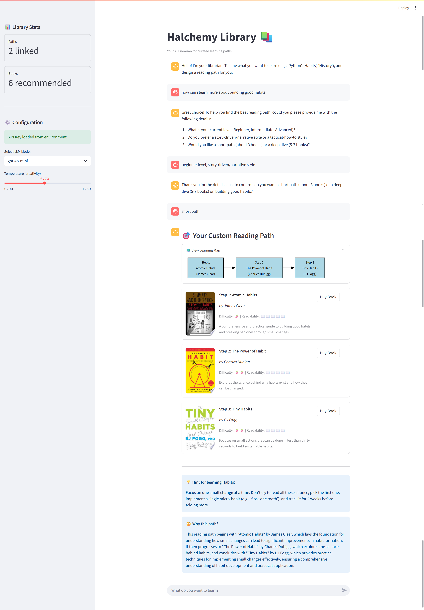

# Halchemy Library 📚

**Halchemy Library** is an AI-assisted reading path recommender designed for *learning*, not just reading. Unlike standard book search tools, it focuses on building a structured "curriculum" of 3–7 books to take you from beginner to competent in a specific domain.

It combines a **curated dataset** (to prevent AI hallucinations) with a **deterministic sequencing engine** and **OpenAI-powered chat** to provide personalized, logical learning journeys.



## ✨ Key Features

- **Ready-made Starter Paths:** Explore Python (3 books, with an advanced stretch goal), habits (3 books), or world history (4 books) immediately. Browse, edit, and export these curated paths without an API key.
- **No-key Path Builder:** Choose a topic, experience level, and depth, with optional subtopic and reading style. Build paths from the curated library, edit them, and download them without an API key. AI explanations are an optional extra.
- **AI Librarian (Chat-to-Query):** Interactive chat interface that translates your learning goals into structured queries.
- **Visual Roadmaps:** Automatic generation of learning maps using Graphviz to visualize your progression.
- **Deterministic Sequencing:** Logic-based ordering of books (e.g., Procedural skills by difficulty, History chronologically).
- **Transparent Recommendations:** Notices explain when a subtopic is broadened, a style preference is relaxed, or fewer books are available than the requested path's minimum (3 for short, 5 for deep).
- **Expert Rationales:** AI-generated explanations of *why* each book was chosen for your specific path.
- **Path Editing:** Reorder, remove, or replace books after a path is generated.
- **Edit by Chat:** Keep selected books, replace steps, reorder, shorten, or expand your current path by describing the change. Chat receives the live path, including manual edits, and selects real books from the curated catalog.
- **Shared Undo:** Chat and manual controls share up to 20 session-local revisions. Say “undo that” or click “Undo last change” to restore the previous path, goal, and explanation. The “What changed” view shows actual additions, removals, and moves.
- **Save and Resume:** Download a session JSON with your path, learning goal, conversation, and undo history. Restore it from the sidebar in a later session without an API key.
- **Multiple Exports:** Download your curated curriculum as a clean Markdown file or a professional PDF.
- **Library Stats:** Track your learning ROI with metrics on generated paths and recommended books.
- **Purchase Links:** Integrated links for direct purchasing when available.

## 🚀 Getting Started

### Prerequisites
- Python 3.11+
- [Graphviz](https://graphviz.org/download/) (required for visual roadmaps)

### Installation

1. **Clone the repository:**
   ```bash
   git clone https://github.com/halchemylab/halchemy-learning-atlas.git
   cd halchemy-learning-atlas
   ```

2. **Set up Environment Variables (optional for starter paths):**
   Copy the example environment file and add your OpenAI API key:
   ```bash
   cp .env.example .env
   # Edit .env and add your OPENAI_API_KEY
   ```
   You can also enter your key in the app sidebar. A key is only required for AI chat and explanations; the path builder, ready-made paths, manual editing, and downloads work without one.

3. **Create a virtual environment:**
   ```bash
   # Windows
   python -m venv .venv
   .\.venv\Scripts\activate

   # Mac/Linux
   python3 -m venv .venv
   source .venv/bin/activate
   ```

4. **Install dependencies:**
   ```bash
   pip install -r requirements.txt
   ```

### Running the App

Start the Streamlit application:
```bash
streamlit run app.py
```

The app will open in your default web browser at `http://localhost:8501`.

### Talk your plan into shape

Open a starter path or describe a learning goal in chat. The conversation and working path appear side by side. Try:

- “Move the second book first.”
- “Keep the first book, but make the rest more practical.”
- “Shorten this to two books. I have two hours a week.”
- “Undo that.”

Chat searches for candidates before adding new books, validates catalog IDs, and applies one complete change per turn. Questions such as “Why this order?” can be answered without editing. A short explanation follows the actual tool result. If an explanation request fails after a successful edit, the edit is retained and can still be undone.

The current path and revision history live in the Streamlit session. Choose **Save session (.json)** in the sidebar to keep a resumable copy of your path, goal, conversation, and up to 20 undo revisions. In a later session, open **Resume a saved session**, upload that JSON, and click **Restore session**. Restoring replaces the current session and requires no API key. Saved files contain your conversation, but no API credentials. Files are limited to 2 MB; books must still exist in the current catalog. Markdown and PDF downloads are readable curriculum copies and include your goal and recommendation warnings. Chat requires an API key; manual editing, undo, and exports do not. Time budgets can be retained in your learning goal, but the catalog has no reading-duration data and the app does not generate a weekly schedule.

## 🧠 How It Works

The system uses a **Hybrid Architecture**:

1.  **Conversation:** An LLM receives your messages and a fresh snapshot of the current path, goal, and undo availability.
2.  **Filtering:** The engine queries `data/books.csv` to find matches from a curated source.
3.  **Sequencing:** A Python-based sorter orders the books based on the learning type (Procedural, History, or Behavioral).
4.  **Actions:** A bounded tool loop searches the catalog, builds a new path, applies an ordered list of verified book IDs, or undoes the last change. Tool results are returned to the model before it explains the outcome, following the [OpenAI function-calling protocol](https://developers.openai.com/api/docs/guides/function-calling).
5.  **Shared Workspace:** Chat and manual edits use the same revision functions. Existing explanations are marked stale after edits and can be refreshed separately.

## 🧪 Testing

The project includes a comprehensive test suite covering data validation and recommendation logic.

Run tests using:
```bash
python -m unittest discover tests
```

CI runs the same command on Python 3.11, 3.12, and 3.13 using the pinned dependencies in `requirements-dev.txt`.

## 📂 Project Structure

```
.
├── app.py                 # Main Streamlit application
├── data/
│   ├── books.csv          # Curated book metadata (Source of Truth)
│   └── roi_stats.json     # Runtime metrics file, generated locally
├── src/
│   ├── books.py           # Filtering and sequencing logic
│   ├── conversation.py    # Validated chat actions and bounded tool loop
│   ├── exports.py         # Markdown and PDF export helpers
│   ├── llm_client.py      # OpenAI integration
│   ├── path_editor.py     # Path editing helpers
│   ├── pdf_gen.py         # PDF report generation logic
│   ├── recommendations.py # Recommendation orchestration
│   ├── roi.py             # Stats tracking and ROI logic
│   ├── utils.py           # Utility functions (e.g., cover fetching)
│   └── workspace.py       # Shared path snapshots, change descriptions, and undo
├── tests/                 # Unit and integration tests
└── docs/
    └── book_data.md       # Guidelines for managing book metadata
```

## 🤝 Contributing

To add more books to the library, edit `data/books.csv`. Please read [docs/book_data.md](docs/book_data.md) for strict guidelines on metadata quality and verification to prevent "hallucinations."
